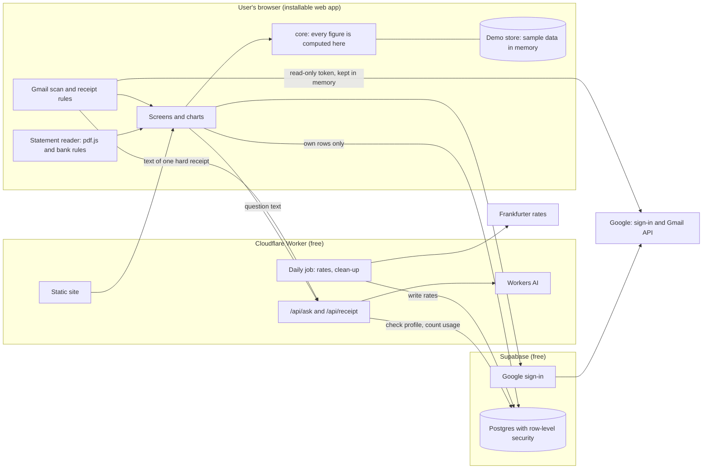

# Tech design: Finance Tracker

Youkai, 12 Nov 2026. For Checkpoint 3. Revised after the reviews by Ghost (QA) and Jinni (design) on pull request 3. Terms are in [`GLOSSARY.md`](../GLOSSARY.md); tables and rules are in [`docs/tech/DATA_MODEL.md`](tech/DATA_MODEL.md); hard-to-reverse choices are in [`docs/adr/`](adr/); tests are in [`TEST_PLAN.md`](TEST_PLAN.md).

**In one paragraph.** A single-page web app does almost all the work in the browser: it reads statements, scans Gmail and computes every figure there. Supabase stores each user's transactions behind row-level security and handles Google sign-in. One small Cloudflare Worker serves the site, fetches exchange rates daily, and passes Ask questions and hard-to-read receipts to an AI model. Statement files and the Gmail token never reach our servers. Email text reaches the Worker only for a receipt our rules cannot read; it is passed to the AI and never stored or logged.

## 1. What the product owner must decide or accept

**Decisions**

| # | Decision | Recommendation |
| --- | --- | --- |
| D1 | **Monopoly's licence is AGPL-3.0, not MIT** as the PRD records. It changed on 17 May 2024. Copying its bank patterns would oblige us to license the whole app under AGPL. | Write our own bank rules from your samples and stay MIT. Alternative: relicense as AGPL and port its patterns. |
| D2 | **Where the Gmail scan runs.** | In the browser, with a one-hour token that is never stored ([ADR 0002](adr/0002-gmail-scan-in-the-browser.md)). The cost: no scanning while the app is closed; the user presses Scan. |
| D3 | **What the 100 counts.** Google counts everyone who ever passed its warning and gives no places back. | Count sign-ups ever made. A deleted account does not free a place. |
| D4 | **AI help for hard receipts.** The text of one email at a time passes through our Worker to the AI. It is not stored, logged or used for training. | Allow it, with Jinni's wording: "The emails are never stored", plus one sentence saying a hard receipt's text is sent to an AI service. Alternative: rules only, more finds marked "Check the amount". |
| D5 | **Exchange rate used.** | The rate on the transaction's own date ([section 8](#8-currencies)). |
| D8 | **Transfers and refunds.** A card bill payment appears on two statements, and a refund is not income. The design adds two kinds beside expense and income: **transfer** (between your own accounts, counted nowhere) and **refund**. | A refund reduces spending in its category in the month it arrives. Alternative: count refunds as income. |
| D9 | **The same purchase from Gmail and from a statement.** The app pairs them, including a USD receipt against an SGD statement line. | Show the pair with "Already have this" preselected; you confirm with the import. Alternative: merge automatically, which is faster but a wrong pair would silently remove a real transaction. |
| D10 | **Invite links.** | One reusable personal link per user, which can be regenerated if it leaks. Alternative: single-use links, safer but one link per friend. |

**To accept**

| # | What | Why |
| --- | --- | --- |
| A1 | **The real Google test the PRD required has not been run.** It needs your Google project. You are accepting Google's documentation for now: weekly re-approval applies only to "Testing" status, and our design holds no long-lived token in any case. Two things remain unproven: that Google does not show its warning again each time a one-hour token is requested, and that Google's window opens from the app installed on an iPhone home screen. | The first Gmail pull request starts with a test on a real iPhone and Android phone, and nothing else on Gmail is built until it passes. If the installed app cannot open Google's window, the scan opens in the phone's browser instead. If the warning repeats, users click through it on each scan. |
| A2 | **Two approved screens change.** The first-scan screen promised "about two minutes". Gmail allows about 100 emails a minute, so a busy year takes 10 to 15. The new promise: first finds within a minute, the newest three months in about 3 to 4 minutes, older months continue while the app is open. The Gmail explainer changes as in D4. | Jinni rewrites both. |
| A3 | **The Gmail connect and disconnect control ships in milestone 2**, with the scan, not in milestone 1. | A control with nothing behind it would mislead. Requirement 3 is otherwise complete in milestone 1. |
| A4 | **Backups.** The free plan has none. We take our own copy before every database change and weekly, kept in private storage. It is not a point-in-time backup. | Enough for release 1; a paid plan before any public launch. |
| A5 | **Sample statements** from each bank you hold, before milestone 2. | A bank with no real sample is reported as unverified, not supported. |

## 2. Accounts the product owner must create (all free)

None should ask for a payment card on its free plan; if one does, stop and tell Phaethon. Keys go through the secure credential form Phaethon opens, or straight into GitHub repository secrets. Never paste them in chat and never commit them.

| Account | Steps | What we need |
| --- | --- | --- |
| **Supabase** | supabase.com → sign in with GitHub → create two projects in region Singapore: `finance-tracker` (live) and `finance-tracker-staging` (database changes are tried here first; it also holds the backups). | For each: project URL and publishable key (public). Secret: the secret key, the database password, and one personal access token (Account → Access tokens). |
| **Cloudflare** | dash.cloudflare.com → sign up → stay on the Free plan (never add Workers Paid: on Free nothing can be charged). My Profile → API Tokens → Create Token → "Edit Cloudflare Workers", plus Workers AI: Read. | Account ID (public). Secret: the API token. |
| **Google Cloud** | console.cloud.google.com → create two projects. **Live:** Google Auth Platform → Branding → Audience: External, then **Publish app** (do not submit for verification) → Data access: add `gmail.readonly` → enable the Gmail API → Clients: a Web application client whose only authorised origin is the app URL. **Development:** the same, left in "Testing" status with the team as test users and `http://localhost:5173` as origin, so that testing never uses up the live project's 100 places. | Both client IDs (public). Paste each client secret yourself into the matching Supabase project (Authentication → Providers → Google); we never see it. |

The invite gate protects our own cap. Google's cap is separate: use the live project only through the live app.

## 3. Stack

| Layer | Choice | Why | Fallback |
| --- | --- | --- | --- |
| Language | TypeScript, strict | One language for app, Worker and tests | |
| App | React, Vite, installable (vite-plugin-pwa) | Largest pool of developers and libraries; static output | |
| Hosting and server code | One Cloudflare Worker with static assets | Site, API and daily job in one deploy; static requests are free | Site on GitHub Pages; API as Supabase Edge Functions |
| Database and sign-in | Supabase (Postgres, row-level security, Google provider) | Isolation enforced by the database, not our code | Neon Postgres with the same migrations; Google ID tokens verified in the Worker |
| Daily job | Worker Cron Trigger | Built in; also keeps the database active | Scheduled GitHub Actions workflow |
| AI | Cloudflare Workers AI. Leading candidate `@cf/meta/llama-3.3-70b-instruct-fp8-fast`; cheaper candidate `@cf/meta/llama-3.1-8b-instruct`. The model id is one config value. | Free daily allowance, no training on inputs, no retention. Both are on the short list of models that accept a JSON Schema; the provider does not guarantee the reply fits it, so every reply is validated. | None free that meets the no-training rule is verified; Ask shows its "used up" state |
| Exchange rates | Frankfurter **v2** (v1 has no TWD) | Free, no key, all six currencies, daily history | fawazahmed0 currency-api (CC0) |
| Statements | pdf.js (Apache-2.0) in a Web Worker, set never to run code from a file; Papa Parse for CSV | Runs in the browser, handles passwords | ADR 0003 |
| Charts | Our own SVG components with d3-scale and d3-shape. Money flow ports the prototype's layout; d3-sankey only if it places nodes the same way. | Keeps the approved look and a small download | Apache ECharts |
| Other | i18next, dnd-kit (desktop pointer and keyboard only; phones use buttons), TanStack Query, Zod, big.js | Existing, maintained, free | |
| Tests and CI | Vitest, Playwright, axe-core, pgTAP, GitHub Actions | | |

## 4. Architecture

1. **Private input stays on the device.** Statement files, passwords and the Gmail token never leave it. Email text leaves only under D4.
2. **One place computes numbers.** The `core` module computes every total, chart, insight, story card and Ask answer from one loaded list ([ADR 0005](adr/0005-compute-every-figure-in-the-browser.md)).
3. **Demo mode is a different store, not a flag.** The adapter is chosen when the app starts; in demo mode no Supabase client or Google script is ever created.

## 5. Modules and who can own them

| Folder | Does | Interface others use | Parallel owner |
| --- | --- | --- | --- |
| `src/core/` | Money, conversion, rounding, kinds, categories, matching, recurring charges, insights, chart queries, month in review. Pure functions; today's date is passed in. | `runQuery`, `matchPairs`, `detectRecurring`, `buildInsights`, `buildReview`, `categorise` | Developer A |
| `src/store/` | Reads and writes the user's data | `DataStore`; adapters `supabase/` and `demo/`, held to one shared contract test | Developer B |
| `src/import/statements/` | File → preview rows. One file and one fixture folder per bank. | `readStatement(file, password?)` | Developer C; banks split further |
| `src/import/gmail/` | Connect, search, paced fetch, finds; the scan runs at app level, not inside a screen | `GmailClient` (adapters: Google, fixtures) | Developer D |
| `src/ask/` | Question → structured query → answer | `AskClient` (adapters: Worker, recorded replies) | Developer E |
| `src/charts/` | SVG chart components from `design/tokens.css`, imported unchanged | One component per chart type | Developer F with Jinni |
| `src/features/<screen>/` | Screens. `overview/` is split into `layout/`, `edit/`, `tabs/`, `builder/`. | Routes | One folder per pull request |
| `src/i18n/<language>/<screen>.json` | Text, one file per screen per language | Message keys | The screen's owner |
| `worker/` | `/api/ask`, `/api/receipt`, daily job | HTTP, validated with Zod | Developer E |
| `supabase/` | Migrations, security rules, database tests, sign-in settings | SQL | Developer B |
| `e2e/` | Ghost's acceptance tests. Youkai does not edit them. | | Ghost |

**Shared files** that many pull requests touch each have one owner and are append-only: the `DataStore` interface and generated database types (B), the sample-data generator (A), the routes file (whoever owns the shell). Migrations are numbered and never edited after merge. A lint rule stops `features/` folders importing each other and stops anything but `store/supabase/` importing the Supabase client.

## 6. Data model

Full tables, rules and limits are in [`DATA_MODEL.md`](tech/DATA_MODEL.md). The points that matter for review:

- **Isolation.** Every user table carries `user_id`; a user with a profile reads and writes only their own rows. A Google account without a profile can do nothing.
- **Transaction kinds:** expense, income, refund, transfer. Transfers are excluded from every measure; bank rules recognise card payments and own-account transfers (D8).
- **Original and billed amounts.** A transaction keeps what the merchant charged (USD 20.00) and, when a statement shows it, what the bank charged (SGD 26.31). Sums use the billed amount when known.
- **Fingerprint.** Each imported row has a fingerprint fixed at import: account, date, amount, description and its position among identical rows that day. Two identical bus fares both import; the same file twice adds nothing; a deleted row does not come back.
- **Matching.** The same purchase from two sources is paired in both directions, with converted amounts within 5% and a date window (D9).
- **Invites.** One reusable, regenerable link per user; a place check before Google; idempotent redemption; refusal cleans up on the server; a one-off script creates the product owner's founder invite (D10).
- **Not stored:** recurring charges, insights and the month in review are computed, so they cannot disagree with the transactions.

## 7. How each requirement is served

"Done at" is the pull request in [section 12](#12-build-plan) that switches the acceptance test on.

| # | Requirement | Modules | Done at | Notable risk |
| --- | --- | --- | --- | --- |
| 1 | Demo mode | `store/demo`, all screens | 12 | Sample dates generated relative to today |
| 2 | Sign-in, invites, onboarding | `features/onboarding`, invite functions | 8 (Gmail step: 21) | Invite links opened inside chat apps, where Google refuses sign-in |
| 3 | Account and privacy controls | `features/settings`, `delete_my_account` | 11 (Gmail control: 21) | Revoking needs a fresh token |
| 4 | Transactions | `features/transactions`, `store` | 9 | Edits must reach every open chart |
| 5 | Currencies | `core/money`, daily job | 10 | Weekend and missing rates |
| 6 | Languages | `i18n` | 6 | CI fails on a key missing in either language |
| 7 | Statement upload | `import/statements`, `core/match` | 15 to 20, one per bank | Real layouts unknown; image-only PDFs unsupported |
| 8 | Gmail scan | `import/gmail`, `/api/receipt` | 22 | Google's window on phones (A1); pace of a first scan |
| 9 | Automatic categories | `core/categorise` | 13 | Merchant names differ between sources |
| 10 | Recurring charges | `core/recurring` | 25 | Amounts that vary slightly |
| 11 | Default dashboards | `charts`, `features/overview/layout` | 29 | Money flow at 375 px |
| 12 | Insights feed | `core/insights` | 27 | False alarms |
| 13 | Custom dashboards | `features/overview`, `dashboards` | 32 | Older app versions reading newer layouts |
| 14 | Ask your money | `ask`, `/api/ask`, `core/query` | 33 | Accuracy on Chinese questions unmeasured |
| 15 | Month in review | `core/review` | 34 | Must reuse the dashboard's functions |
| 16 | Export | `core/csv` | 35 | Cells starting with `=`, `+`, `-`, `@` are made safe |

## 8. Currencies

The daily job stores each currency's rate against SGD with the time it was fetched. **A transaction is converted at the rate on its own date.** A finished month's total then stops moving, comparisons between months mean something, and Ghost's hand calculations stay valid. Today's rate would be simpler but would change every past total daily. Rounding happens once, when a figure is shown; the exact rule is in `DATA_MODEL.md` section 6. Rates are stored for every currency the source publishes, so a receipt in MYR or THB still converts. History is loaded once by a script, not by the scheduled job.

## 9. Security and privacy

- **Gmail token.** A read-only token lives about one hour in the browser's memory. It is never written to storage or sent to us; there is no refresh token. It could read the whole mailbox for that hour; "reads only the matches" describes what our code does (search, then fetch only the ids returned), and the content security policy is what stops any other script using it.
- **Disconnecting.** Revoking needs a live token, so Disconnect first asks Google for one (one tap), then revokes. If the user closes Google's window, the app still stops: it marks Gmail disconnected, never requests a token again, and shows how to remove access in the Google account. Deleting the account revokes first, then deletes.
- **"Nothing is saved until you accept."** Finds and previews wait on the device, so closing the app does not lose them; they are cleared on sign-out or disconnect. The database receives a row only on accept.
- **The AI endpoints.** `/api/ask` and `/api/receipt` refuse anyone without a profile. A question is at most 300 characters, a receipt 4,000, a reply 300 tokens. One database function checks and counts in a single step against the user's daily row (10 questions, 20 receipts) and a shared daily row. Calling that function directly gains nothing: it applies the same caps.
- **Logs.** Request bodies are never logged, in the Worker or the database: no questions, receipt text or emails.
- **Stored:** transaction fields, a label and a hash for each card or account, rules, dashboards, settings, name and email. **Never stored:** statement files, PDF passwords, full account numbers, email bodies, Google tokens, Ask questions.
- **Account deletion.** One function deletes the sign-in record and every row cascades, except that people the user invited are kept. The device cache is cleared.
- **Sign-in settings** live in the repository. Email, password and anonymous sign-in are off in the live project; the deploy smoke test fails if any of them is on.
- **Browser hardening.** Strict content security policy; the only third-party script is Google's. No analytics.

## 10. Scale

At 100 users the data is about 60 MB a year against 500 MB. What gives out first:

1. **The AI allowance.** 10,000 Neurons a day for everyone. A call costs about 50 to 60 on the leading model, so about 150 a day. Up to 3,000 Neurons are kept for receipts. When it is spent the app shows the approved "used up" state until 00:00 UTC (8:00 am in Singapore), the same moment the per-user count resets.
2. **Gmail's pace** on a first scan (about 100 emails a minute).
3. **Google's 100-user cap.**
4. **Database egress**, 5 GB a month. Loading is paged, cached on the device and fetches only changes, so a normal start moves a few kilobytes.
5. **History in the browser.** Fine to about 20,000 rows per user; beyond that, load by date range and sum in the database behind the same `core` interface.

A public launch would need Google's verification and yearly security assessment (paid), a paid database plan, paid AI, a custom domain, rate limiting and monitoring. None changes the module map.

## 11. CI/CD, environments and secrets

| When | Workflow |
| --- | --- |
| Every pull request | Lint, type check, unit tests, translation-key check, build with a 200 KB compressed first-load limit, database tests on a local Supabase, Playwright acceptance tests with axe and screenshot baselines, then a preview URL |
| Merge to `main` | Back up the live database to private storage; apply migrations to staging, then live; deploy; smoke test |
| Weekly | Backup; Ghost's live run of the 20 Ask questions |

- **Environments:** local (Supabase in Docker, seeded test users, development Google project), preview (site only, demo store, no `/api`), staging (second Supabase project), live.
- CI never calls the real model on a pull request; it replays recorded replies.
- **Branch protection on `main`:** pull request required, all checks green, up to date, no force pushes, squash merge. If agents share one GitHub account, Ghost's review is a recorded comment and Phaethon merges.
- **Secrets:** GitHub Actions holds the Cloudflare token, the Supabase access token and database passwords. The Worker holds the Supabase secret key. Public values live in a committed config file. Backups are never uploaded as workflow artifacts. Preview jobs do not run for forks.

## 12. Build plan

One line is one pull request. Ghost's acceptance test lands first, marked expected-to-fail, and the pull request named in section 7 switches it on. "∥" means buildable at the same time.

**Milestone 1, Foundation.** (1) Scaffold: shell, tokens, routes, CI, size limit, screenshot harness, `.gitignore`; needs no accounts. Then ∥: (2) deploy pipeline and previews; (3) `core` money, rounding, injected date, sample-data generator; (6) languages. Then ∥: (4) `DataStore`, contract test, demo adapter, transactions screen; (5) database schema, rules, limits, invite and delete functions, staging and backup; (7) money-flow chart component. Then ∥: (8) place check, Google sign-in, invite, refusal, currency and language onboarding; (9) Supabase adapter with paged, cached loading; (10) rates job and currency switch. Then ∥: (11) settings: hide amounts and theme (applied before first paint), invite link, delete account; (12) landing page with the live money flow, demo banner, install.

**Milestone 2, Import.** (13) Categories and merchant rules, interface first. Then ∥: (14) statement engine: PDF, password, lines, bank recognition, kinds, fingerprint, matching, preview, one-call import, CSV; (21) Gmail: **test on a real iPhone and Android phone first**, then explainer screen, connect and disconnect, search, paced fetch, scan that survives navigation and resumes. Then ∥: (15) DBS/POSB, (16) OCBC, (17) UOB, (18) Citibank, (19) Standard Chartered, (20) HSBC, each needing a sample; (22) receipt rules, first-scan and review screens, matching in review; (23) AI help for hard receipts.

**Milestone 3, Insight.** (24) Written rules for recurring charges and the four insights, with thresholds, approved before Ghost writes tests. Then ∥: (25) recurring charges; (26) remaining chart components. Then (27) insight rules and feed, after 25; ∥ (28) overview: sentence, flow, pace; then (29) remaining default charts.

**Milestone 4, Make it yours.** ∥: (30) dashboards saved, tabs, edit mode; (31) Ask endpoint and structured query. Then ∥: (32) chart builder; (33) Ask screen, pin, used-up state.

**Milestone 5, Delight.** ∥: (34) month in review; (35) CSV export and re-import. Then (36) final speed and accessibility check.

**Accepted review items handled during build**

| Item | Pull request |
| --- | --- |
| Size limit and load-on-demand for the PDF reader, drag library, Ask and import (Ghost 9) | 1, then each feature |
| `.gitignore` for secrets, reports and private samples (Ghost note 8) | 1 |
| Screenshot baselines at 375 and 1280, light and dark, both languages; Jinni reviews copy on each preview | 1 onwards |
| Invite opened inside a chat app: detect and say "open in your browser"; the code survives sign-in (Ghost 14) | 8 |
| Money flow: Table button, text labels on yellow and pink, dots under blur | 7 |
| dnd-kit announcements translated; resizing keeps the width button | 30 |
| States Jinni designs first: total mismatch, image-only PDF, unsure kind (14); likely match (14, 22); Google prompt declined (21); Ask "cannot answer that" (33) | as listed |
| Delete dialog says a new invite is needed to return | 11 |

## 13. Risks and fallbacks

| Risk | Fallback |
| --- | --- |
| A bank's real layout defeats text extraction | That bank's CSV export; the bank is reported unverified until a sample passes |
| Google's window fails in the installed app on a phone, or the warning repeats (A1) | Scan in the phone's browser; the redirect form of the same browser flow |
| Supabase pauses a quiet project or changes its free plan | The daily job writes every day (should count as activity, not guaranteed); restore is one click; plain Postgres moves to Neon |
| Workers AI allowance, model list or terms change; newer models need a paid method | The model id is one config value; Ask degrades as designed; nothing else depends on AI |
| Frankfurter is down or drops TWD | The job tries the second source the same day; the last rate stays in use |
| Gmail's quota page now mentions a daily project threshold of 80,000,000 units "before charges apply", details to come | Far above 100 users' use (a full first scan is about 80,000). Watch the page; never add billing to the Google project |
| Google's sign-in prompt shows an unfamiliar address | Sign-in uses Google's button on our own page; if the Supabase address still appears, the explainer says so |
| A wrong migration damages live data | Staging first, backup before every migration |

## 14. Verified and assumed

**Verified against official documentation on 12 Nov 2026** (links in the ADRs; Ghost spot-checked six of these): Google's 7-day expiry applies to "Testing" status only; unverified live apps show a warning and are capped at 100 new users; the browser token model has no refresh token and needs a user action; Supabase, Workers, Workers AI and GitHub Actions free limits as quoted; Workers AI does not train on or retain inputs; JSON Schema output is supported on a listed set of models; Gmail quota figures; Monopoly's licence and bank list.

**Verified by trying it:** Frankfurter v2 and the fallback returned SGD to TWD for today and past dates. pdf.js opened a generated two-page statement, plain and locked three ways, reported a wrong password distinctly, and one pattern parsed all 58 rows with a sum equal to the printed total.

**Not verified, assumed:**

- Real statements from the six banks contain selectable text and keep rows on one baseline. The spike used a file we generated (A5).
- An unverified live app behaves as documented after 7 days. The PRD's real test is outstanding (A1).
- Google does not repeat the unverified-app warning each time a one-hour token is requested (A1).
- Google's window opens from the app installed on an iPhone or Android home screen (A1).
- Sign-in with Google's button on our page shows our app, not the Supabase address.
- The cost per AI call and the accuracy on the 20 questions, especially in Chinese.
- A daily database write prevents Supabase pausing.
- The 5% tolerance and the date window for matching are a starting point; they will be tuned on the product owner's real data.
- Console labels in section 2 may differ slightly.
