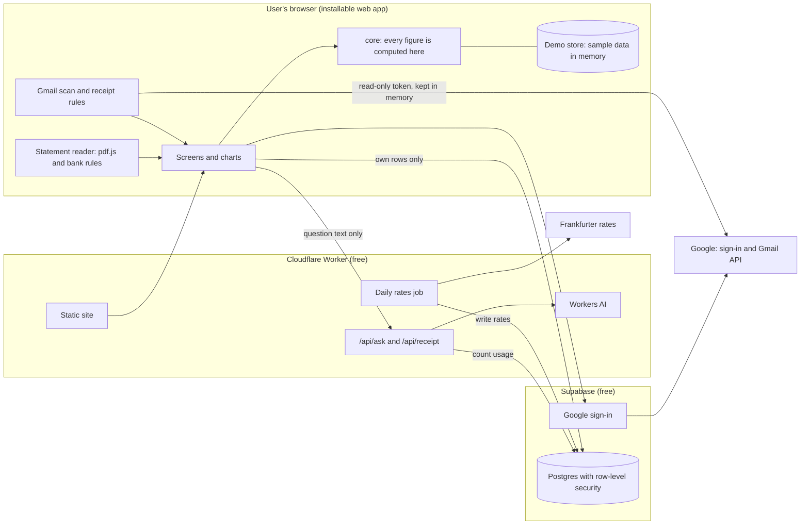

# Tech design: Finance Tracker

Youkai, 12 Nov 2026. For Checkpoint 3. Jinni and Ghost comment on the pull request before the product owner reviews. Terms are defined in [`GLOSSARY.md`](../GLOSSARY.md); the hard-to-reverse choices are recorded in [`docs/adr/`](adr/).

**In one paragraph.** A single-page web app does almost all the work in the browser: it reads statements, scans Gmail and computes every figure there. Supabase stores each user's transactions behind row-level security and handles Google sign-in. One small Cloudflare Worker serves the site, fetches exchange rates daily and turns Ask questions into structured queries. Statement files, emails and the Gmail token never reach our servers.

## 1. What the product owner must decide

| # | Decision | Recommendation |
| --- | --- | --- |
| D1 | **Monopoly's licence is not MIT.** The repository switched to AGPL-3.0 on 17 May 2024 and is now published as `monopoly-core`; the PyPI page the PRD cites (`monopoly-sg`) stopped at an old version and still says MIT. Copying its bank patterns would oblige us to license the whole app under AGPL. | Write our own bank rules from your sample statements and keep the MIT licence. We reuse only the approach (identify the bank, find the table header, match rows, check the total). Alternative: relicense the app as AGPL and port the patterns directly. |
| D2 | **Where the Gmail scan runs.** | In the browser, with a one-hour access token that is never stored or sent to us ([ADR 0002](adr/0002-gmail-scan-in-the-browser.md)). The cost: a scan runs only while the app is open, and the user clicks Scan each time. No background scanning. |
| D3 | **What the 100-user cap counts.** Google counts every user who has ever passed the warning screen, and does not give places back. | Count sign-ups ever made, not current accounts. A deleted account does not free a place. |
| D4 | **AI help for hard receipts.** When our rules cannot read a matched receipt, its text (trimmed, one email at a time) can be sent to the AI to extract the four fields. It is not stored and not used for training, but it does leave the device. | Allow it, and add one sentence to the Gmail explainer (Jinni). Alternative: rules only, with more finds marked "Check the amount". |
| D5 | **Exchange rate used for conversion.** | The rate on the transaction's own date ([section 8](#8-currencies)). |
| D6 | **No automatic database backups on the free plan.** | Accept for release 1. Users can export CSV, and all schema changes are in the repository. Revisit before inviting people beyond friends. |
| D7 | **Sample statements** from each bank you hold (already promised). | Needed before milestone 2. Bank rules for a bank without a sample cannot be accepted. |

## 2. Accounts the product owner must create (all free)

None of the three should ask for a payment card on its free plan; if one does, stop and tell Phaethon. Keys go through the secure credential form Phaethon opens, or straight into GitHub repository secrets. Never paste them in chat and never commit them.

| Account | Steps | What we need |
| --- | --- | --- |
| **Supabase** | supabase.com → sign in with GitHub → New project, name `finance-tracker`, region Singapore, generate a database password. | Project URL and publishable key (public, safe to commit). Secret: the secret key, the database password, and a personal access token (Account → Access tokens). |
| **Cloudflare** | dash.cloudflare.com → sign up → stay on the Free plan (do not add Workers Paid: on Free, nothing can ever be charged). My Profile → API Tokens → Create Token → template "Edit Cloudflare Workers", then add the permission Workers AI: Read. | Account ID (public). Secret: the API token. |
| **Google Cloud** | console.cloud.google.com → new project → Google Auth Platform → Branding (app name, support email) → Audience: External, then **Publish app** (do not submit for verification) → Data access: add `gmail.readonly` → enable the Gmail API → Clients: create a Web application client; authorised JavaScript origins are the app URL and `http://localhost:5173`; authorised redirect URI is the callback URL shown on Supabase's Google provider page. | Client ID (public). Paste the client secret yourself into Supabase → Authentication → Providers → Google; we never need to see it. |

GitHub Actions is already free for this public repository.

## 3. Stack

| Layer | Choice | Why | Fallback |
| --- | --- | --- | --- |
| Language | TypeScript, strict | One language for app, Worker and tests | |
| App | React, Vite, installable (vite-plugin-pwa) | Largest pool of developers and libraries; static output | |
| Hosting and server code | One Cloudflare Worker with static assets | Site, API and daily job in one deploy; static requests are free and unlimited | Site on GitHub Pages; API as Supabase Edge Functions |
| Database and sign-in | Supabase (Postgres, row-level security, Google provider) | Per-user isolation enforced by the database, not by our code | Neon Postgres with the same migrations; verify Google ID tokens in the Worker |
| Daily job | Worker Cron Trigger | Built in; also keeps the database active | A scheduled GitHub Actions workflow |
| AI | Cloudflare Workers AI, an open-weight model with JSON Schema output | Free daily allowance, no training on inputs, no retention | None free that meets the no-training rule has been verified; Ask shows its "used up" state |
| Exchange rates | Frankfurter v2 | Free, no key, covers all six currencies including TWD, daily history | fawazahmed0 currency-api (CC0, dated files on a CDN) |
| Statements | pdf.js (Apache-2.0) in a Web Worker; Papa Parse for CSV | Runs in the browser, handles passwords | See ADR 0003 |
| Charts | Our own SVG components with d3-scale, d3-shape, d3-sankey | The prototype already draws its charts as plain SVG; keeps the approved look and a small download | Apache ECharts |
| Other libraries | i18next (languages), dnd-kit (drag and reorder), TanStack Query (data loading), Zod (validating anything from outside) | Existing, maintained, free | |
| Tests and CI | Vitest, Playwright, axe-core, pgTAP, GitHub Actions | | |

## 4. Architecture

Three rules shape everything else:

1. **Private input stays on the device.** Statement files and emails are read in the browser. Only accepted transaction fields are sent to the database.
2. **One place computes numbers.** The browser loads the user's transactions once and the `core` module computes every total, chart, insight, story card and Ask answer from them. This is how "one number, everywhere" from the design is kept true ([ADR 0005](adr/0005-compute-every-figure-in-the-browser.md)).
3. **Demo mode is a different store, not a flag.** The app talks to data through one interface with two adapters: Supabase and an in-memory sample. In demo mode no Supabase client or Google script is ever created, so there is no path to real data.

## 5. Modules and who can own them

Each module has a small interface and hides its detail. A developer changes one folder and its tests; shared types change only through `core`.

| Folder | Does | Interface others use | Depends on | Parallel owner |
| --- | --- | --- | --- | --- |
| `src/core/` | Money, conversion, categories, recurring charges, insights, chart queries, month in review. Pure functions, no network. | `runQuery(transactions, rates, query)`, `detectRecurring`, `buildInsights`, `buildReview`, `categorise` | nothing | Developer A |
| `src/store/` | Reads and writes the user's data | `DataStore` (adapters: `supabase/`, `demo/`) | core types | Developer B |
| `src/import/statements/` | File → preview rows. One file per bank in `banks/`. | `readStatement(file, password?) → StatementPreview` | pdf.js | Developer C; one bank each can be split further |
| `src/import/gmail/` | Search, fetch matches, extract finds | `scan(since) → Find[]` behind `GmailClient` (adapters: Google, fixtures) | core types | Developer D |
| `src/ask/` | Question → structured query → answer | `ask(question) → Answer` behind `AskClient` (adapters: Worker, canned) | core | Developer E |
| `src/charts/` | SVG chart components from the design tokens | One component per chart type | tokens | Developer F with Jinni |
| `src/features/<screen>/` | Screens: overview, transactions, import, recurring, insights, ask, review, settings, onboarding | Routes | all above | One folder per feature pull request |
| `src/i18n/` | English and Traditional Chinese text | Message keys | | Anyone; one file per language |
| `worker/` | `/api/ask`, `/api/receipt`, daily rates job | HTTP, validated with Zod | Workers AI, Supabase | Developer E |
| `supabase/` | Migrations, security rules, database tests | SQL | | Developer B |
| `e2e/` | Ghost's acceptance tests. Youkai does not edit them. | | | Ghost |

Collision rules: migrations are numbered files and never edited after merge; every bank is its own file plus its own fixture folder; text keys are namespaced by screen; a lint rule stops `features/` folders importing each other and stops anything but `store/supabase/` importing the Supabase client.

## 6. Data model

Amounts are whole numbers in the currency's smallest unit (cents; yen have none). Every user table has `user_id` and the same rule: **a signed-in user can read and write only rows where `user_id` is their own id.** Deleting the user removes every row through cascading foreign keys.

| Table | Key columns | Row-level security |
| --- | --- | --- |
| `profiles` | `user_id`, `display_currency`, `language`, `invite_code`, `invited_by`, `gmail_connected`, `last_scan_at`, `last_review_seen` | Read and update own row. Created only by the `redeem_invite` function. |
| `signup_counter` | one row: `total` | No direct access. `redeem_invite(code)` checks the code, locks the row, refuses at 100, increments, creates the profile. |
| `transactions` | `id`, `user_id`, `occurred_on`, `amount_minor`, `currency`, `direction` (expense, income), `merchant`, `description`, `category`, `source` (manual, statement, csv, gmail), `fingerprint`, `import_id` | Own rows. Insert requires a profile. Unique on (`user_id`, `fingerprint`) so the same row cannot be imported twice. |
| `imports` | `id`, `user_id`, `kind`, `bank`, `period`, `file_hash`, `row_count`, `total_minor` | Own rows. A record that a statement was imported; never the file. |
| `dismissed_finds` | `user_id`, `fingerprint` | Own rows. Remembers a rejected find by a hash, so it is not offered again. |
| `category_rules` | `user_id`, `merchant_key`, `category` | Own rows. |
| `dashboards` | `id`, `user_id`, `name`, `position`, `charts` (JSON, checked against a schema) | Own rows. |
| `insight_dismissals` | `user_id`, `insight_key` | Own rows. |
| `ai_usage` | `user_id`, `day`, `calls` | Read own. Written only by the `consume_ai_allowance` function. |
| `exchange_rates` | `rate_date`, `currency`, `per_sgd`, `source` | Any signed-in user can read. Only the daily job writes. |

Recurring charges, insights and the month in review are not stored: they are computed from transactions, so they can never disagree with them. The category list is fixed in code and translated. A user signed in with Google but without a profile (no valid invite, or cap reached) can read and write nothing; the app shows the refusal and removes the empty sign-in record.

## 7. How each requirement is served

| # | Requirement | Modules | Notable risk |
| --- | --- | --- | --- |
| 1 | Demo mode | `store/demo`, all screens | Sample dates must be generated relative to today |
| 2 | Sign-in, invites, onboarding | `features/onboarding`, `supabase` (`redeem_invite`) | Two sign-ups racing for place 100: solved by the row lock |
| 3 | Account and privacy controls | `features/settings`, `supabase` (`delete_my_account`), `import/gmail` (revoke) | Blur must cover chart labels too |
| 4 | Transactions | `features/transactions`, `store` | Edits must update every open chart: one cached list, one source |
| 5 | Currencies | `core/money`, `worker` (rates job) | A missing day's rate: use the nearest earlier day |
| 6 | Languages | `i18n` | A CI check fails the build on a key missing in either language |
| 7 | Statement upload | `import/statements` | Real layouts unknown until samples arrive; scanned (image) PDFs are out of scope |
| 8 | Gmail scan | `import/gmail`, `worker` (`/api/receipt`) | Gmail allows about 100 full messages a minute per user, so a first scan is paced and shows progress |
| 9 | Automatic categories | `core/categorise`, `category_rules` | Merchant names differ between sources; one normalising function |
| 10 | Recurring charges | `core/recurring` | Amounts that vary slightly (utilities) |
| 11 | Default dashboards | `charts`, `core/query`, `features/overview` | Money-flow diagram at 375 px |
| 12 | Insights feed | `core/insights` | False alarms; thresholds are fixed by Ghost's test data |
| 13 | Custom dashboards | `features/overview`, `dashboards` table | Layout JSON must stay readable by older app versions |
| 14 | Ask your money | `ask`, `worker` (`/api/ask`), `core/query` | Model accuracy on Chinese questions is unmeasured |
| 15 | Month in review | `core/review`, `features/review` | Must reuse the dashboard's functions, not copy them |
| 16 | Export | `core/csv`, `import/statements` (CSV) | Round trip must keep original currency and fingerprint |

## 8. Currencies

The daily job stores one rate per currency per day against SGD, and on first run backfills history. **A transaction is converted at the rate on its own date.** Reasons: a finished month's total stops moving, so comparisons between months mean something and Ghost's hand calculations stay valid; it is close to what the bank actually charged. Today's rate would be simpler but would change every past total daily. The acceptance test "rates no more than 24 hours old" is met by the daily job. Rates are reference rates and the app says so; the original amount is always kept and shown.

## 9. Security and privacy

- **Gmail token.** A read-only access token lives about one hour in the browser's memory. It is not written to storage, not sent to the Worker or Supabase, and there is no refresh token. Disconnecting revokes the grant with Google, so "no further Gmail reads" holds by construction.
- **"Reads only the matches."** The scan sends Gmail a search query, receives message ids, and fetches only those messages.
- **"Nothing is saved until you accept."** Finds and statement previews exist only in the browser until accepted. The database receives a row only on accept. A rejected find is remembered as a hash.
- **Stored:** transaction fields, category rules, dashboards, settings, Google's name and email for sign-in. **Never stored:** statement files, PDF passwords, email bodies, Google tokens, Ask questions.
- **Never leaves the device:** statement files and passwords; emails (except under D4); the transaction history (the AI receives the question, today's date and the category names only).
- **Account deletion.** One database function deletes the sign-in record and every row cascades. The app then revokes the Google grant and clears local storage. Ghost's test counts rows for that user in every table.
- **Isolation.** Row-level security on every table, tested in CI with two users. The Supabase secret key exists only in the Worker's daily job.
- **Browser hardening.** A strict content security policy; the only third-party script is Google's sign-in library. No analytics.

## 10. Scale

At 100 users the data is small: about 60 MB a year against 500 MB, and well under 1% of the Worker's 100,000 daily requests. What gives out first, in order:

1. **The AI allowance.** 10,000 Neurons a day for everyone. By our estimate a call costs about 50 (roughly 900 tokens in, 120 out), so about 200 calls a day in total. We reserve up to 3,000 for receipts and cap each user at 10 questions a day. When the allowance is spent the Worker says so and the app shows the approved "used up" state until 00:00 UTC.
2. **Gmail's per-user rate** on a large first scan (paced, newest three months first).
3. **Google's 100-user cap.**
4. **Loading all transactions into the browser.** Fine to about 20,000 rows per user. Beyond that, load by date range and move sums into database functions; `core` keeps the same interface.

A public launch would need: Google's verification and the yearly security assessment for Gmail access (paid), a paid database plan (backups, no pausing), paid AI, a custom domain, rate limiting and monitoring. None of these changes the module map.

## 11. CI/CD, environments and secrets

| When | Workflow |
| --- | --- |
| Every pull request | Lint and format check, type check, unit tests, translation-key check, build, database tests against a local Supabase, Playwright acceptance tests (demo store and local Supabase) with axe, then a preview URL for the branch posted on the pull request |
| Merge to `main` | Apply migrations, deploy the Worker and site, smoke test the live URL |

- **Environments:** local (Supabase CLI in Docker, sign-in by test users), preview (per pull request, demo store only, no production data), production. One Supabase project; the free plan allows two, so a staging project can be added later.
- **Branch protection on `main`:** pull request required, all checks green, branch up to date, no force pushes, squash merge. If all agents share one GitHub account, "one approval" cannot be enforced by GitHub; Ghost's review is then recorded as a pull request comment and merging is done by Phaethon.
- **Secrets:** GitHub Actions holds the Cloudflare API token, the Supabase access token and database password. The Worker holds the Supabase secret key. Public values (project URL, publishable key, Google client ID, Cloudflare account ID) live in a committed config file. Preview jobs do not run for forks.

## 12. Build plan

Each line is one pull request; Ghost's acceptance test lands first. "∥" marks pull requests that can be built at the same time.

**Milestone 1, Foundation.** (1) Scaffold, design tokens, app shell, CI and deploy. (2) `core` money and conversion, sample-data generator. Then ∥: (3) `DataStore` with the demo adapter and the transactions screen; (4) database schema, security rules and their tests; (5) languages. Then ∥: (6) Google sign-in, invite, cap refusal, onboarding; (7) Supabase adapter; (8) rates job and currency switch. Then ∥: (9) settings: privacy blur, delete account, Gmail connect and disconnect; (10) landing page, demo banner, install to home screen.

**Milestone 2, Import.** (11) Statement engine: open PDF, password prompt, rebuild lines, recognise bank, preview, duplicates, total check; CSV. Then ∥, one per bank, each needing a sample: (12) DBS/POSB, (13) OCBC, (14) UOB, (15) Citibank, (16) Standard Chartered, (17) HSBC. In parallel with the banks: (18) Gmail search and paced fetch; (19) receipt rules and the review screen; (20) AI help for hard receipts; (21) categories and merchant rules.

**Milestone 3, Insight.** ∥: (22) recurring charges; (23) chart components; (24) insight rules. Then (25) overview default layout, split into sentence and money flow, then the remaining charts; (26) insights feed.

**Milestone 4, Make it yours.** ∥: (27) dashboards saved, tabs, edit mode; (28) Ask endpoint and structured query. Then ∥: (29) chart builder; (30) Ask screen, pin to tab, used-up state.

**Milestone 5, Delight.** ∥: (31) month in review; (32) CSV export and re-import. Then (33) speed and accessibility pass against the PRD's targets.

## 13. Risks and fallbacks

| Risk | Fallback |
| --- | --- |
| A bank's real layout defeats text extraction (image-only PDF, odd fonts) | That bank's CSV export; the bank is marked unsupported until a sample passes |
| Supabase pauses a quiet project after 7 days, or changes its free plan | The daily job writes every day, which should count as activity (not guaranteed). Restore is one click. Schema is plain Postgres and moves to Neon |
| Workers AI allowance, model list or terms change | Model id is one config value. Ask degrades as designed; nothing else depends on AI |
| Frankfurter is down or drops TWD | The job tries the second source the same day; yesterday's rate stays in use |
| Google changes the unverified-app rules | Statement upload and manual entry do not depend on Gmail |
| The same purchase arrives from Gmail and from a statement | Not merged automatically. The review screen marks a likely match (same amount, within 3 days); the duplicate insight catches the rest |
| No backups (D6) | CSV export; manual database dump before each milestone |

## 14. Verified and assumed

**Verified against official documentation on 12 Nov 2026** (links in the ADRs): Google's 7-day token expiry applies to "Testing" status only; unverified production apps show a warning and are capped at 100 new users; the browser token model issues short-lived tokens without a refresh token; Supabase, Cloudflare Workers, Workers AI and GitHub Actions free limits as quoted; Workers AI does not train on or retain inputs; JSON Schema output is supported; Gmail quota figures; Monopoly's licence and bank list (read from its repository).

**Verified by trying it:** Frankfurter v2 and the fallback both returned SGD to TWD for today and for past dates. pdf.js in Node opened a generated two-page statement, both plain and locked three ways (RC4-128, AES-128, AES-256), reported a wrong password distinctly, and after rebuilding lines from text positions one pattern parsed all 58 rows with a sum equal to the printed total.

**Not verified, assumed:**
- That real statements from the six banks contain selectable text and keep rows on one baseline. The spike used a statement we generated. Needs the samples (D7).
- That an unverified production app behaves as documented after 7 days. No real test was possible without the Google project; the PRD asked for one. With ADR 0002 no refresh token exists, so the only thing left to observe is whether the warning reappears. We will check on day 8 after the project exists.
- The cost per AI call (our token estimate) and the model's accuracy on the 20 test questions, especially in Chinese. Needs a Cloudflare account.
- That a daily database write prevents Supabase pausing. Supabase says only "low activity".
- Sign-up steps in section 2 follow each provider's current documentation; console labels may differ slightly.
